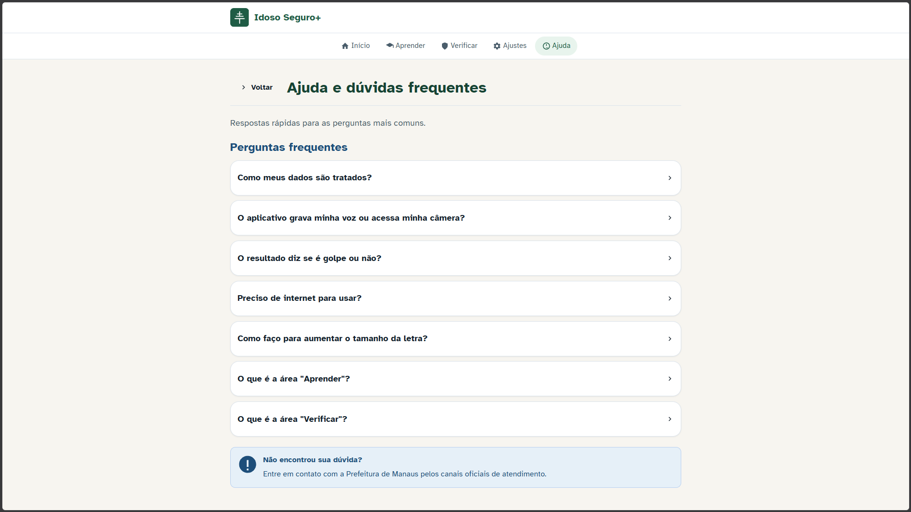

# Idoso Seguro+ Manaus

Aplicação web acessível, educativa e preventiva de segurança digital para pessoas idosas. O sistema reúne aulas curtas sobre golpes comuns e uma área para verificar mensagens e links suspeitos, com leitor de tela embutido, alto contraste e controle de tamanho de fonte. O conteúdo educativo fica no SQLite; a análise é feita por um motor Python determinístico, sem LLM e sem armazenar o que a pessoa envia.

**Instituição:** Centro Universitário CEUNI FAMETRO  
**Curso:** Análise e Desenvolvimento de Sistemas / Noturno  
**Orientadora:** Profa. Luana Leal

**Demonstração:** http://31.97.147.114:8085/ — ambiente em VPS externa, gerenciado separadamente deste repositório.

## Imagens

| Tela inicial | Modo Aprender |
|---|---|
|  |  |

| Tela de verificação | Acessibilidade |
|---|---|
|  |  |

| Ajuda e dúvidas frequentes |
|---|
|  |

> Capturas da versão em demonstração. A tela de verificação dessa versão inclui a ajuda guiada de 3 perguntas; o código local versionado ainda não contém esse fluxo.

## Sobre o projeto

### Problema e persona

**Dona Raimunda Alves**, 67 anos, moradora de Manaus-AM, tem nível tecnológico básico: usa o celular para WhatsApp, chamadas e Pix, mas não reconhece com segurança links falsos, pedidos de senha ou falsos parentes. O projeto foi desenhado para ela e para outras pessoas idosas que precisam de linguagem simples, letras grandes, alto contraste e apoio auditivo.

### Objetivos de Desenvolvimento Sustentável

- **ODS 4 — Educação de qualidade:** aulas curtas e gratuitas sobre segurança digital.
- **ODS 10 — Redução das desigualdades:** interface acessível para quem tem pouca familiaridade com tecnologia.
- **ODS 16 — Paz, justiça e instituições eficazes:** prevenção a fraudes e proteção da pessoa idosa.

## Funcionalidades

| Área | O que está implementado |
|---|---|
| **Modo Aprender** (rota `#ensinar`) | 7 temas com aula curta, sinais de alerta, ações seguras, exemplo e quiz. |
| **Modo Assistir** | Verificação de **texto** e **link** com nível de risco (baixo, atenção, alto), indícios encontrados, orientações e indicação do conteúdo educativo relacionado. |
| **Leitor de tela (TTS)** | Leitura em voz alta com 4 velocidades: lenta (0.8), normal (1.0), rápida (1.5) e muito rápida (2.0). |
| **Alto contraste** | Paleta de alto contraste aplicada ao aplicativo inteiro. |
| **Tamanho do texto** | 4 níveis: pequeno, normal, grande e muito grande. |
| **Navegação assistiva** | Teclado e gestos de toque; estrutura de comandos de voz (em desenvolvimento); regra dos dois toques para ativar itens. |
| **Quiz** | Uma pergunta por vez, com resumo final. |
| **Ajuda** | Página com **7 perguntas frequentes**. |
| **Preferências** | Modo leitor, contraste e tamanho de fonte são salvos no `localStorage`. |
| **Service worker** | Cache de arquivos estáticos do aplicativo. |

### Em desenvolvimento

| Recurso | Situação real |
|---|---|
| **Reconhecimento de voz (STT)** | O botão e o módulo existem, mas a captura pelo microfone ainda não está estável. Não deve ser apresentado como funcional. |
| **Upload e análise automática de foto** | O seletor de imagem existe, mas a foto **não é analisada automaticamente**. A verificação usa o texto que a pessoa descreve. |
| **Análise de imagem e áudio** | Hoje entram como **descrição em texto**; não há OCR nem transcrição automática. |

> A página **Ajuda** reúne 7 perguntas frequentes. A versão em demonstração também oferece uma ajuda guiada de 3 perguntas na tela de verificação.

### Modo Aprender — 7 temas

1. Links Suspeitos
2. Golpes no WhatsApp
3. Senhas e Dados
4. Pix e Transferências
5. Falsa Central Bancária
6. Promoções Falsas
7. CPF e Documentos

### Modo Assistir — como a análise funciona

> Na versão em demonstração, essa área aparece como **Verificar**. No código local, a rota é `#assistir`.

A pessoa escolhe o tipo, escreve ou cola o conteúdo e envia. O resultado mostra:

- **Nível de risco:** baixo (< 25), atenção (25–59) ou alto (≥ 60).
- **Indícios:** regras de texto (urgência, pedido de senha, falso benefício, falso parente, Pix, prêmio falso, presença de link, engenharia social, pressão emocional) e regras de URL (sem HTTPS, IP na URL, encurtador, TLD suspeito, typosquatting, domínio complexo).
- **Orientações:** o que fazer e o que evitar.
- **Conteúdo relacionado:** link para a aula educativa correspondente.

A análise é **IA simbólica baseada em regras heurísticas determinísticas**, executada em Python. **Não usa LLM** e **não armazena** o conteúdo enviado.

### Ciclo assistivo-educativo (diferencial)

1. A pessoa relata uma situação no **Assistir**.
2. O sistema mostra risco, indícios e orientações.
3. O resultado aponta a aula relacionada.
4. A pessoa aprende o tema no **Aprender** e consolida com o quiz.
5. Ela pode voltar ao **Assistir** para verificar uma nova mensagem.

O ciclo une **assistência imediata** e **educação preventiva**: o sistema apoia a decisão, mas não decide pela pessoa.

### Acessibilidade

- **TTS** com 4 velocidades e voz `pt-BR` quando disponível no navegador.
- **Leitor de tela embutido** (não substitui NVDA ou TalkBack).
- **Alto contraste** e **4 tamanhos de fonte**.
- **Foco visível**, skip link, landmarks e navegação por teclado.
- **Atalhos:** `Alt+L` liga/desliga o leitor; setas navegam; `Enter`/`Espaço` ativam; `H` título, `B` botão, `L` lista, `T` texto, `M` menu; `P` lê tudo; `S` resumo; `C` contexto; `R` repete; `Esc` cancela/desliga.
- **Gestos:** deslizar, toque longo e dois dedos.
- **Redução de movimento** e alvos de toque ampliados.

## Requisitos

### Requisitos funcionais

| Código | Requisito | Onde está no código |
|---|---|---|
| RF01 | Selecionar o modo Aprender ou Assistir | `public/js/router.js`, `public/js/pages/home.js` |
| RF02 | Consultar os conteúdos educativos | `GET /api/conteudos`, `src/controllers/educationController.js` |
| RF03 | Apresentar situações exemplificativas | `database/seed.sql` (campo `example_text`) |
| RF04 | Enviar conteúdo para verificação | `POST /api/analises`, `public/js/pages/analisar.js` |
| RF05 | Analisar indícios no texto e no link | `motor-analise/estrategias/texto.py`, `link.py` |
| RF06 | Mostrar os indícios encontrados | `public/js/pages/resultado.js` |
| RF07 | Oferecer orientação preventiva | `motor-analise/regras.py` (`construir_recomendacoes`) |
| RF08 | Relacionar o resultado a um conteúdo educativo | `motor-analise/regras.py` (`inferir_tema_educativo`) |
| RF09 | Refazer a análise, voltar ou trocar o modo | `public/js/pages/resultado.js` |

### Requisitos não funcionais

| Código | Requisito |
|---|---|
| RNF01 | **Acessibilidade visual e motora (WCAG 2.2 AA):** contraste adequado, foco visível, navegação por teclado, alvos de toque ampliados, 4 tamanhos de fonte e alto contraste. |
| RNF02 | **Acessibilidade assistiva e cognitiva (WCAG 2.2):** leitor de tela embutido, TTS com 4 velocidades, atalhos, gestos, estrutura de comandos de voz (em desenvolvimento) e linguagem simples em português. |

## Estrutura do Projeto

```text
IdosoSeguro/
├── server.js                  # Express + Helmet + rate limit + SPA
├── package.json
├── .env.example
├── database/
│   ├── schema.sql
│   └── seed.sql               # 7 temas, conteúdos e quiz
├── motor-analise/             # motor Python determinístico
│   ├── main.py
│   ├── analisador.py
│   ├── regras.py
│   └── estrategias/
│       ├── texto.py
│       └── link.py
├── src/
│   ├── adapters/
│   │   └── pythonAdapter.js
│   ├── controllers/
│   │   ├── analysisController.js
│   │   └── educationController.js
│   ├── database/
│   │   └── db.js
│   ├── repositories/
│   │   ├── quizRepository.js
│   │   └── topicRepository.js
│   ├── routes/
│   │   └── apiRoutes.js
│   └── services/
│       ├── analysisService.js
│       └── educationService.js
├── public/
│   ├── index.html
│   ├── manifest.json
│   ├── service-worker.js
│   ├── css/
│   │   ├── variables.css
│   │   ├── reset.css
│   │   ├── components.css
│   │   ├── accessibility.css
│   │   └── responsive.css
│   ├── js/
│   │   ├── app.js
│   │   ├── router.js
│   │   ├── events.js
│   │   ├── action-router.js
│   │   ├── api.js
│   │   ├── accessibility.js
│   │   ├── components.js
│   │   ├── sw-register.js
│   │   ├── pages/
│   │   │   ├── welcome.js
│   │   │   ├── home.js
│   │   │   ├── ensinar.js
│   │   │   ├── conteudo.js
│   │   │   ├── quiz.js
│   │   │   ├── assistir.js
│   │   │   ├── analisar.js
│   │   │   ├── resultado.js
│   │   │   ├── acessibilidade.js
│   │   │   ├── ajuda.js
│   │   │   └── fechamento.js
│   │   └── accessibility/
│   │       ├── screen-reader.js       # orquestrador/fachada
│   │       ├── page-reader.js
│   │       ├── chunk-descriptor.js
│   │       ├── speech-engine.js
│   │       ├── destinos.js
│   │       └── inputs/
│   │           ├── keyboard.js
│   │           ├── gestures.js
│   │           ├── focus.js
│   │           └── voice-commands.js
│   ├── fonts/
│   │   ├── atkinson-hyperlegible-400.woff2
│   │   ├── atkinson-hyperlegible-400-italic.woff2
│   │   └── atkinson-hyperlegible-700.woff2
│   └── assets/
│       ├── icons.svg
│       ├── logo.svg
│       └── illustrations/     # SVGs e casal-capa.png
├── tests/
│   ├── backend.test.js
│   ├── leitor.test.js
│   ├── contraste-audit.js
│   ├── atualizar-snapshots.js
│   └── snapshots/             # JSON de referência do leitor
├── docs/
│   ├── REGISTRO_DE_CORRECOES.md
│   ├── ERRO_EXPORT_SYNTAX_CORRECAO.md
│   ├── ROTEIRO-APRESENTACAO.md
│   └── screenshots/           # capturas usadas no README
├── uploads/
│   ├── .gitkeep
│   └── generate_pdf.py
└── generate_pdf.py
```

> `node_modules/`, `database/*.db`, `.env` e `__pycache__/` não são versionados. Pastas vazias (`src/config/`, `src/middlewares/`, `public/assets/icons/`, `python/`) não aparecem na árvore porque não têm arquivos versionados.

## Tecnologias Utilizadas

| Camada | Tecnologia |
|---|---|
| **Front-end** | HTML5, CSS3 (variáveis, grid e flexbox), JavaScript ES6+ com ES Modules, hash router e Web Speech API. |
| **Back-end** | Node.js 18+, Express, Helmet (CSP) e `express-rate-limit`. |
| **Motor de análise** | Python 3.9+, regras heurísticas determinísticas. |
| **Banco de dados** | SQLite via pacote `sqlite3`. |
| **Service worker** | Cache de arquivos estáticos; não há garantia de uso offline completo. |
| **Testes** | Node test runner, `jsdom` e snapshots do leitor. |
| **Sem** | Firebase, login, cadastro ou coleta de dados do usuário. |

### Arquitetura e padrões de projeto

| Padrão | Onde está | Função |
|---|---|---|
| **Adapter** | `src/adapters/pythonAdapter.js` | Adapta a chamada do Node para o motor Python, com timeout e fallback. |
| **Repository** | `src/repositories/topicRepository.js`, `quizRepository.js` | Isola o acesso ao SQLite do restante da aplicação. |
| **Strategy** | `motor-analise/estrategias/texto.py`, `link.py` | Estratégias diferentes de análise conforme o tipo de conteúdo. |
| **Facade** | `public/js/accessibility/screen-reader.js` | Orquestra `page-reader`, `chunk-descriptor` e `speech-engine` por trás de uma interface única. |

Fluxo resumido:

```text
Pessoa → Interface (HTML/CSS/JS) → API REST (Node/Express)
       → Motor Python → Resultado
       → SQLite (conteúdo educativo)
```

### API

| Método | Rota | Função |
|---|---|---|
| GET | `/api/saude` | Verifica se o servidor está no ar. |
| GET | `/api/conteudos` | Lista os 7 temas. |
| GET | `/api/conteudos/:slug` | Detalha um tema e seu conteúdo. |
| GET | `/api/conteudos/:slug/quiz` | Retorna as perguntas do quiz. |
| POST | `/api/analises` | Analisa `texto`, `link`, `imagem` ou `audio` (imagem/áudio usam descrição textual). |

As respostas seguem o padrão `{ "ok": true, "dados": ... }` ou `{ "ok": false, "erro": { "codigo": "...", "mensagem": "..." } }`.

## Como Executar

### Pré-requisitos

- Node.js 18 ou superior
- Python 3.9 ou superior
- npm

### Passos

```bash
# 1. Instalar as dependências
npm install

# 2. Criar e popular o banco SQLite (idempotente)
npm run db:criar

# 3. Iniciar o servidor
npm start
```

Acesse: **http://localhost:3000**

Opcionalmente, crie um `.env` a partir do `.env.example`:

```env
PORT=3000
PYTHON_CMD=python
NODE_ENV=development
```

Para rodar os testes:

```bash
npm test
```

### Voz e HTTPS

O reconhecimento de voz **está em desenvolvimento**. Além disso, o navegador só libera o microfone em **HTTPS** ou em **localhost**.

- Em `http://localhost:3000`, o microfone pode ser liberado pelo navegador.
- Em **HTTP** (como no servidor atual `http://31.97.147.114:8085`), o microfone é **bloqueado**.
- Para testar voz em produção, é necessário servir o site por **HTTPS**.

## Status Atual e Limitações

### Funciona

- Modo Aprender com 7 temas, aulas, exemplos e quiz.
- Modo Assistir para **texto** e **link**, com nível, indícios e orientações.
- Leitor de tela com TTS em 4 velocidades.
- Alto contraste e 4 tamanhos de fonte.
- Navegação por teclado e gestos.
- Página Ajuda com 7 perguntas frequentes.
- Persistência local das preferências de acessibilidade.

### Em desenvolvimento

- **Reconhecimento de voz (STT):** botão e módulo presentes, captura ainda instável.
- **Upload e análise automática de foto:** seletor presente, foto não analisada automaticamente.

### Limitações conhecidas

- Imagem e áudio são tratados como **texto descrito**; não há OCR nem transcrição.
- O service worker guarda arquivos estáticos, mas **não há promessa de funcionamento offline completo**: aulas e análises dependem da API.
- O reconhecimento de voz depende do navegador e de HTTPS ou localhost.
- O servidor de demonstração é uma **VPS externa**, atualizada separadamente deste repositório.

### Privacidade

- O conteúdo enviado para análise **não é armazenado** em banco, logs ou arquivos.
- A análise é sem estado.
- Não há login, cadastro ou histórico de análises.
- O SQLite guarda apenas o conteúdo educativo (temas, aulas e quiz).

## Autor(es) e Orientação

| Nome | Registro |
|---|---|
| John Erik de Araujo Santos | 2422168 |
| Franciane de Carvalho Nogueira | 2418640 |
| Kauan Ferreira dos Santos | 2422557 |

**Instituição:** Centro Universitário CEUNI FAMETRO  
**Curso:** Análise e Desenvolvimento de Sistemas / Noturno  
**Orientadora:** Profa. Luana Leal

## Referências

- VAN DIJK, Jan. **The Digital Divide**. Polity, 2020.
- HELSPER, Ellen. **The Digital Disconnect**. 2021.
- GRILLI, et al. 2021.
- SOMMERVILLE, Ian. **Engenharia de Software**. 10. ed. 2019.
- PRESSMAN, Roger; MAXIM, Bruce. **Engenharia de Software**. 9. ed. 2021.
- ISO/IEC 25010:2023 — **Systems and software Quality Requirements and Evaluation (SQuaRE)**.
- ISO/IEC 25059:2023 — **Quality model for AI systems**.
- W3C. **Web Content Accessibility Guidelines (WCAG) 2.2**. 2023.
