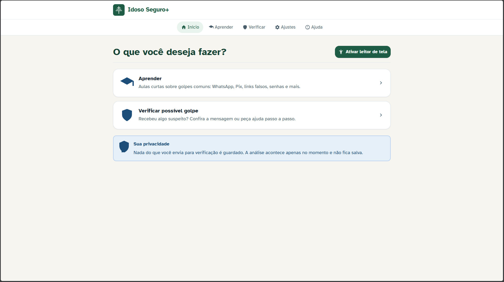
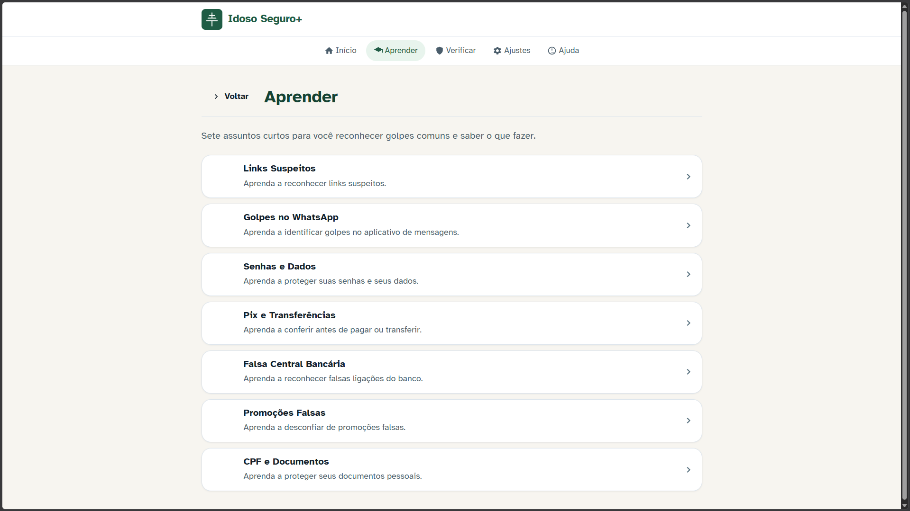
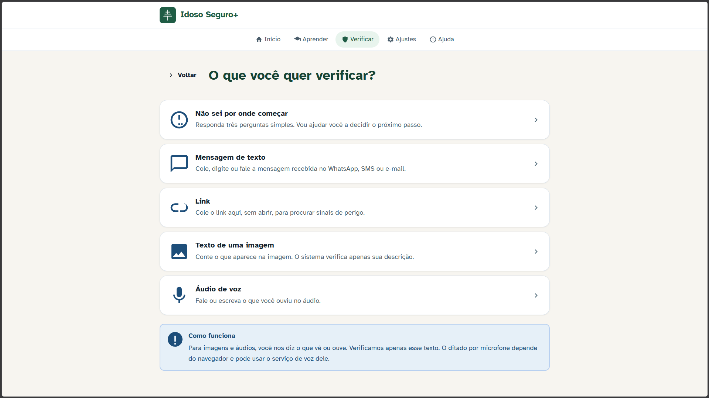
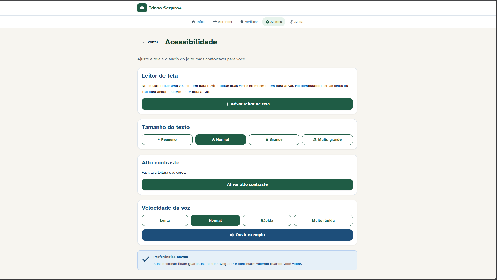

# Idoso Seguro+ Manaus

Aplicação web acessível e educativa para prevenção de golpes digitais contra pessoas idosas. Tem dois modos: **Aprender**, com 7 aulas curtas e quiz, e **Assistir/Verificar**, que analisa mensagens e links e orienta o que fazer.

**Instituição:** Centro Universitário CEUNI FAMETRO  
**Curso:** Análise e Desenvolvimento de Sistemas / Noturno  
**Orientadora:** Profa. Luana Leal  
**Alunos:** John Erik de Araujo Santos (2422168), Franciane de Carvalho Nogueira (2418640), Kauan Ferreira dos Santos (2422557)

**Demo:** http://31.97.147.114:8085/ — VPS externa, atualizada separadamente.

---

## Imagens

| Tela inicial | Aprender |
|---|---|
|  |  |

| Verificar | Ajustes |
|---|---|
|  |  |

| Ajuda |
|---|
|  |

---

## Funcionalidades

| Recurso | Situação |
|---|---|
| **Aprender** (rota `#ensinar`, 7 temas com aula, exemplo e quiz) | Funcional |
| **Assistir/Verificar** (texto e link, com IA simbólica baseada em regras) | Funcional |
| **Ajuda guiada de 3 perguntas** | Funcional |
| **Leitor de tela (TTS)** com 4 velocidades | Funcional |
| **Alto contraste** e **4 tamanhos de fonte** | Funcional |
| **Ajuda** com 7 perguntas frequentes | Funcional |
| **Reconhecimento de voz (STT)** | Em desenvolvimento |
| **Upload e análise automática de foto** | Em desenvolvimento |

Imagem e áudio são analisados como **texto descrito**; não há OCR nem transcrição automática.

---

## Sobre

**Persona:** Dona Raimunda Alves, 67 anos, Manaus-AM, nível tecnológico básico. Usa WhatsApp, chamadas e Pix, mas tem dificuldade de reconhecer links falsos, pedidos de senha e falsos parentes.

**ODS:** 4 (educação de qualidade), 10 (redução das desigualdades) e 16 (paz, justiça e instituições eficazes).

**Ciclo assistivo-educativo:** Verificar → entender risco, indícios e orientações → estudar a aula relacionada → responder ao quiz → refazer a verificação.

---

## Requisitos

**RF01–RF09:** RF01 seleção do modo; RF02 consulta de conteúdos; RF03 situações exemplificativas; RF04 envio de conteúdo; RF05 análise de texto/link; RF06 exibição de indícios; RF07 orientação preventiva; RF08 conteúdo educativo relacionado; RF09 refazer, voltar ou trocar de modo.

**RNF01–RNF02:** RNF01 acessibilidade visual e motora (WCAG 2.2 AA: contraste, foco visível, teclado, alvos ampliados, 4 fontes e alto contraste); RNF02 acessibilidade assistiva e cognitiva (leitor embutido, TTS com 4 velocidades, atalhos, gestos e linguagem simples).

---

## Padrões de projeto

- **Adapter** — `src/adapters/pythonAdapter.js`
- **Repository** — `src/repositories/`
- **Strategy** — `motor-analise/estrategias/`
- **Facade** — `public/js/accessibility/screen-reader.js`

---

## Estrutura

```text
IdosoSeguro/
├── server.js
├── package.json
├── database/            # schema.sql e seed.sql
├── motor-analise/       # main.py, regras.py e estrategias/
├── src/                 # adapters, controllers, repositories, routes, services
├── public/
│   ├── index.html
│   ├── css/
│   ├── js/              # app, router, events, pages e accessibility
│   ├── assets/
│   └── fonts/
├── tests/
├── docs/                # inclui screenshots/
└── uploads/
```

---

## Tecnologias

- **Front-end:** HTML5, CSS3, JavaScript ES6+ (ES Modules) e Web Speech API.
- **Back-end:** Node.js + Express, Helmet e rate limit; motor em Python 3.9+.
- **Dados:** SQLite.
- **Extras:** service worker; sem Firebase, login ou cadastro.

---

## Como executar

Requisitos: **Node.js 18+** e **Python 3.9+**.

```bash
npm install
npm run db:criar
npm start
```

Acesse `http://localhost:3000`. Para rodar os testes: `npm test`.

**Voz:** o reconhecimento de voz está em desenvolvimento e o navegador só libera o microfone em **HTTPS** ou **localhost**. Em HTTP, o microfone é bloqueado.

---

## Status e limitações

- **Funciona:** Aprender, Assistir/Verificar (texto/link), ajuda guiada, TTS, contraste, fontes, quiz e Ajuda.
- **Em desenvolvimento:** reconhecimento de voz e análise automática de foto.
- Imagem/áudio usam descrição textual; o service worker não garante offline completo.
- O servidor de demonstração é externo e atualizado separadamente.
- O conteúdo da análise não é gravado no banco.

---

## Autores

John Erik de Araujo Santos (2422168), Franciane de Carvalho Nogueira (2418640) e Kauan Ferreira dos Santos (2422557). Orientação: Profa. Luana Leal — CEUNI FAMETRO, ADS/Noturno.

---

## Referências

VAN DIJK (2020); HELSPER (2021); GRILLI et al. (2021); SOMMERVILLE (2019); PRESSMAN; MAXIM (2021); ISO/IEC 25010:2023; ISO/IEC 25059:2023; W3C WCAG 2.2 (2023).
